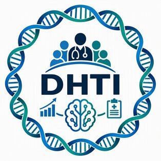
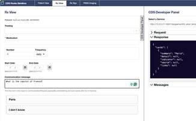
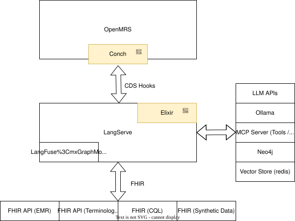

<p align="center">
  
</p>

[](https://www.npmjs.com/package/dhti-cli)
[](https://www.npmjs.com/package/dhti-cli)
[](https://nuchange.ca)
[](https://www.npmjs.com/package/dhti-cli)
[](https://dermatologist.github.io/dhti/)
[](https://github.com/dermatologist/dhti/wiki)

<!-- Punch line -->

> 🚀 Built for forward‑deployed engineers (FDE) in healthcare!

# DHTI

_DHTI enables rapid prototyping, sharing, and testing of GenAI healthcare applications inside an EHR, helping experiments move smoothly into practice. DHTI also includes [skills](/.agents/skills/) that generate GenAI components from problem‑oriented [prompts](/.agents/skills/start-dhti/examples/e2e-sample.md)._

### Why?

Imagine you need to instantly determine whether a patient qualifies for a clinical trial. Your GenAI app pulls in the trial’s eligibility criteria, matches it against the patient’s EHR data, taps a vector store for RAG, relies on a self‑hosted LLM to keep everything private, and uses smart tools to fetch and analyze clinical details. The final output appears right inside the EHR—clean, clear, and clinician‑friendly. 💥 **And that’s just one example of the countless real‑world workflows DHTI makes possible.**

#### How? (Technical):

Generative AI features are built as [LangServe Apps](https://python.langchain.com/docs/langserve/) (elixirs). All backend data exchange is done through the **FHIR API** (a [base class](https://github.com/dermatologist/dhti-elixir-base) provides all these features) and displayed using CDS-Hooks. dhti-cli simplifies this process by providing a CLI that includes managing a Docker Compose with all additional components, such as [Ollama](https://ollama.com/) for **local LLM hosting**. LLM and hyperparameters are **injected at runtime** and can be easily swapped. In essence, dhti decouples GenAI modules from the rest of the system.

🚀 You can test the elixir using a real EMR system, [OpenMRS](https://openmrs.org/), that communicates with the elixir using **CDS-Hooks** or use any other CDS-Hooks compatible EMR system. You can also use the [CDS-Hooks sandbox for testing](https://github.com/dermatologist/cds-hooks-sandbox/tree/dhti-1) without an EMR.

🚀 Checkout **[Vidhi Recipes](/vidhi/README.md)** for chatbot, RAG, imaging (DICOM) and MCPX for dockerized calculators

#### How (non‑technical / clinical)

DHTI includes ready‑to‑use [skills](.agents/skills/) that can prompt agentic platforms (e.g., [AntiGravity](https://antigravity.google/), VSCode, or Claude) to generate the GenAI backends and UI components (elixirs and conches) you need. Test these components with synthetic data in OpenMRS or the CDS‑Hooks sandbox, then hand them off to production teams. Because DHTI follows open standards, that handoff (the "valley of death") becomes smoother and more predictable. Try the [prompts](.agents/skills/start-dhti/examples/e2e-sample.md) in your preferred agentic platform after cloning this repo.

Other skills from the open agent skills ecosystem may be useful too! For example, use `npx skills find clinical trial` to find clinical trial related skills. From the results, you can use `npx skills add <skill-name>` to use the skill in your agentic platform. (e.g.`npx skills add anthropics/healthcare@clinical-trial-protocol-skill`)

## **🤖 [Vibe Coding Workflow with GitHub Copilot SDK](/notes/COPILOT.md)**

- [Install the Copilot CLI](https://github.com/features/copilot/cli), set up authentication and try out the following commands!
  > npx dhti-cli copilot --model gpt-5.3-codex --skill elixir-generator --prompt "Generate an elixir glycemic_advisor that summarizes diabetic patients' latest lab results and medications"

> npx dhti-cli copilot --model gpt-5.3-codex --skill start-dhti --prompt "Start the glycemic_advisor elixir and display in CDS-Hooks sandbox"

## 👩 Human Workflow

[[Cheatsheet](/notes/cheatsheet.md) | [Download PDF Cheatsheet](https://nuchange.ca/wp-content/uploads/2026/01/dhti_cheatsheet.pdf)]

- Requirements: [Node.js](https://nodejs.org/) and [Docker](https://www.docker.com/). Optionally install [Python](https://www.python.org/) to develop or rapidly prototype elixirs.
- The sample elixir will use Google, OpenAI, or OpenRouter models if API keys are set in your environment; otherwise it falls back to a mock LLM. You can also use [Ollama](https://ollama.com/) for local model hosting. See [setup instructions](/notes/setup-ollama.md).

Quick start (try the demo script):

```bash
git clone https://github.com/dermatologist/dhti.git
cd dhti
./demo.sh    # Linux / macOS (Windows: use WSL)
```

Basic demo workflow:

```bash
# All commands use ~/dhti as the default working directory
npx dhti-cli help                         # list commands
npx dhti-cli compose add -m langserve     # add LangServe to ~/dhti/docker-compose.yml
npx dhti-cli compose read                 # view generated compose
npx dhti-cli elixir install -g https://github.com/dermatologist/dhti-elixir.git -n dhti-elixir-schat -s packages/simple_chat
npx dhti-cli docker ~/dhti -n yourdockerhandle/genai-test:1.0 -t elixir  # build Docker image
npx dhti-cli docker -u                    # start services from compose
```

Notes:

- Install from a local directory using `-l` flag.
- Stop and remove the Docker Compose stack with `npx dhti-cli docker -d`.

✌️ Decide where to test the new elixir: OpenMRS a full EHR system, or CDS-Hooks sandbox for a lightweight testing without an EHR.

💥 Test elixir in a CDS-Hooks sandbox.

**Prerequisites:** Ensure `yarn`, `corepack`, and Docker Compose are installed.

```bash
npx dhti-cli elixir start -n dhti-elixir-schat
```

- The elixir endpoint will be: `http://localhost:8001/langserve/dhti_elixir_schat/cds-services`
- By default, uses `hapi.fhir.org/baseR4` as the FHIR server (use `-f` flag to specify a different endpoint)
- The CDS-Hooks sandbox will be cloned to `~/dhti/cds-hooks-sandbox` if it doesn't exist
- Navigate to the sandbox URL displayed in the console output
- In the **Rx View** tab, type in the contentString textbox and wait for the elixir to respond (Submits automatically in 5 seconds)

<p align="center">
  
</p>

- We recommend using the [order-select](https://cds-hooks.org/hooks/order-select/) hook, utilizing the contentString from the [FHIR CommunicationRequest](https://build.fhir.org/communicationrequest.html) within the [cds-hook context](https://cds-hooks.org/examples/) for user inputs but you can use patient-view if no user input is needed.

💥 Test elixir in OpenMRS.

**Option A: Install an existing conch from GitHub (flat clone):**

```bash
npx dhti-cli conch install -g dermatologist/openmrs-esm-dhti -n esm-chatbot-agent
npx dhti-cli conch start -w ~/dhti -n esm-chatbot-agent
```

**Option B: Create a new conch from template (monorepo):**

```bash
# Creates workspace/openmrs-esm-dhti with a new package
npx dhti-cli conch init -w /path/to/workspace -n esm-dhti-myconch
# Then run the printed start command (uses --local and --sources flags)
```

**Option C: Install from local directory:**

```bash
# Copy local conch to ~/dhti/myconch
npx dhti-cli conch install -l /path/to/local/conch -n myconch
npx dhti-cli conch start -w ~/dhti -n myconch
```

**Note:** The `-s` (sources) flag is only used with `start` for monorepos. For flat clones (created by `install`), use `-w` (workdir) and `-n` (name) flags instead.

- Go to `http://localhost:8080/openmrs/spa/home`
- Login with the following credentials:
  - Username: admin
  - Password: Admin123

You will see the new **patient context aware chatbot** in the patient summary page. This is just an example. You can build your own! Check the implementation in the [elixir repo](https://github.com/dermatologist/dhti-elixir) and [conch repo](https://github.com/dermatologist/openmrs-esm-dhti).

<p align="center">
  
</p>

- `npx dhti-cli docker -d` to stop and remove the Docker Compose stack (containers and networks).

## Configuration

- `npx dhti-cli docker bootstrap -f bootstrap.py` manages the bootstrap.py file for LangServe configuration:
  - If `bootstrap.py` exists locally: copies it to the container and restarts the service
  - If `bootstrap.py` does not exist locally: copies it from the container to your local directory
  - Use this to configure default models and hyperparameters for LangServe

## Wiki & Documentation

- [](https://github.com/dermatologist/dhti/wiki)
- [Documentation](https://dermatologist.github.io/dhti/)
- [CLI Reference](/notes/README.md)

## User contributions & examples

- 🚀 **[Vidhi Recipes](/vidhi/README.md)** for chatbot, RAG, imaging (DICOM) and MCPX for dockerized calculators
- [Elixirs](https://github.com/dermatologist/dhti-elixir)
- [OpenMRS Conches / UI](https://github.com/dermatologist/openmrs-esm-dhti)
- [CDS Hooks Sandbox for testing](https://github.com/dermatologist/cds-hooks-sandbox)

## Presentations

- ⭐️ **Pitched at the [Falling Walls Lab Illinois](https://falling-walls.com/falling-walls-lab-illinois) and released on 2025-09-12.**
- ⭐️ **Version 1 was introduced at the [Medical Informatics Europe Conference 2026 (Genoa, Italy)](https://mie2026.efmi.org/), May 26-28, 2026.**

## Publications

- ⭐️ [Eapen, B. R. and Singh, N. Navigating the “Valley of Death”: An Open-Source, Modular Framework for Generative AI in Healthcare. In Opening the Personal Gate between Technology and Health Care, pages 1561–1562. IOS Press.](https://ebooks.iospress.nl/volumearticle/78765?_gl=1*1udo1ua*_up*MQ..*_ga*MTUyODU1NjMuMTc4MDU0MTc3NQ..*_ga_6N3Q0141SM*czE3ODA1NDE3NzQkbzEkZzEkdDE3ODA1NDE3ODkkajQ1JGwwJGgw)

## 🔧 What problems do DHTI solve?

| Why                                                                                                           | How                                                                                                                                                                                                                                                                                                                                                                                                                                                                                                                                                                                                                                                                                 |
| ------------------------------------------------------------------------------------------------------------- | ----------------------------------------------------------------------------------------------------------------------------------------------------------------------------------------------------------------------------------------------------------------------------------------------------------------------------------------------------------------------------------------------------------------------------------------------------------------------------------------------------------------------------------------------------------------------------------------------------------------------------------------------------------------------------------- |
| I am a clinician! I have no idea how to build GenAI apps.                                                     | ✨ DHTI comes with batteries ([skills](.agents/skills/)) included! Use your preferred agentic platform (e.g., [AntiGravity](https://antigravity.google/), [VSCode with Copilot in agent mode](https://code.visualstudio.com/docs/copilot/overview), Claude, [Cursor](https://cursor.com/) and many other) to generate elixirs and conches from [problem-oriented prompts](.agents/skills/start-dhti/examples/e2e-sample.md) (most of these platforms have a free tier). Test them using synthetic data in OpenMRS or the CDS-Hooks sandbox, then hand them off to production teams. You may find useful skills in the open agent skills ecosystem. `npx skills find clinical trial` |
| I know LangChain, but I don’t know how to build a chain/agent based on data in our EHR.                       | [These sample elixirs](https://github.com/dermatologist/dhti-elixir) adopt FHIR and cds-hooks as standards for data retrieval and display. The [base class](https://github.com/dermatologist/dhti-elixir-base) provides reusable artifacts                                                                                                                                                                                                                                                                                                                                                                                                                                          |
| I need a simple platform for experimenting.                                                                   | This repository provides everything to start experimenting fast. The command-line tools help to virtualize and orchestrate your experiments using [Docker](https://www.docker.com/)                                                                                                                                                                                                                                                                                                                                                                                                                                                                                                 |
| I am a UI designer. I want to design helpful UI for real users.                                               | See [these sample conches](https://github.com/dermatologist/openmrs-esm-dhti). It shows how to build interface components (conches) for [OpenMRS](https://openmrs.org/) an open-source EMR used by many. Read more about [OpenMRS UI](https://o3-docs.openmrs.org/)                                                                                                                                                                                                                                                                                                                                                                                                                 |
| We use another EMR                                                                                            | Your EMR may support CDS-Hook for displaying components. In that case, you can use [cds-hooks-sandbox for testing](https://github.com/dermatologist/cds-hooks-sandbox/tree/dhti-1)                                                                                                                                                                                                                                                                                                                                                                                                                                                                                                  |
| We don't use an EMR. We use a web based health information system for ------ population with no FHIR support. | You can still use DHTI as a GenAI experimentation platform. ✨ We have a [browser extension](https://github.com/dermatologist/openmrs-esm-dhti/blob/develop/packages/dhti-screen-grabber/README.md) that can read any web page!                                                                                                                                                                                                                                                                                                                                                                                                                                                     |
| Our IT team is often unable to take my experiments to production.                                             | Use DHTI, follow the recommended patterns, and you will make their lives easier.                                                                                                                                                                                                                                                                                                                                                                                                                                                                                                                                                                                                    |

## Architecture

<p align="center">
  
</p>

## ✨ Features

- **Modular**: Supports installable Gen AI routines and UI elements.
- **Quick prototyping**: CLI helps in quick prototyping and testing of Gen AI routines and UI elements.
- **Easy to use**: Can be installed in a few minutes.
- **Developer friendly**: Copy working files to running containers for testing.
- **Dry-run mode**: Preview changes before execution with the `--dry-run` flag.
- **Local directory installation**: Install elixirs and conches from local directories using the `-l` flag.
- **Monorepo support**: Install elixirs and conches from subdirectories in GitHub repositories with the `-s` flag.
- **Dependency Injection**: Dependency injection for models and hyperparameters for configuring elixirs.
- **Generate synthetic data**: [DHTI supports generating synthetic data for testing, using synthea.](/notes/SYNTHEA.md)
- **CQL support**: [CQL for clinical decision support](https://nuchange.ca/2025/06/v-llm-in-the-loop-cql-execution-with-unstructured-data-and-fhir-terminology-support.html).
- **FHIR**: Data exchange with FHIR schema.
- **MCP**: Built in MCP server for pluggable tools.
- **EMR**: Built in EMR, OpenMRS, for patient records.
- **Vector store**: Redis for vector store.
- **Monitoring**: LangFuse for monitoring.
- **Graph utilities**: Neo4j for graph utilities.
- **LLM**: Ollama for self-hosting LLM models.

## ✨ Advanced Features

- **start-dhti skill**: New AI agent skill that orchestrates complete DHTI application development - from generating elixirs and conches to starting a fully functional DHTI server.
- **MCPX integration**: DHTI now includes an [MCP integrator](https://docs.lunar.dev/mcpx/) that allows other MCP servers to be "installed" and exposed seamlessly to DHTI through the MCPX gateway.
- **DOCKTOR module**: A new module, [DOCKTOR](/notes/DOCKTOR.md), supports traditional machine‑learning models packaged as Docker containers. These can be used as MCP tools to deploy inference pipelines as agent‑invokable tools (in beta).
- **MCP aware agent**: [dhti-elixir-template](https://github.com/dermatologist/dhti-elixir-template) used in the examples now includes an [MCP aware agent](https://github.com/dermatologist/dhti-elixir-template/blob/feature/agent-2/src/dhti_elixir_template/chain.py) that can autodiscover and invoke tools from the MCPX gateway. Install it using `npx dhti-cli elixir install -g https://github.com/dermatologist/dhti-elixir-template.git -n dhti-elixir-template -b feature/agent2`.
- **Medplum integration**: [Medplum](https://www.medplum.com/) is now supported as an alternative FHIR server. Read more [here](/notes/medplum.md). This allows you to add FHIR subscriptions for real-time updates and much more.
- **Synthea integration**: You can now generate synthetic FHIR data using [Synthea](https://synthetichealth.github.io/synthea/). Read more [here](/notes/SYNTHEA.md).
- **MIMIC support**: You can now load [MIMIC Demo](https://physionet.org/content/mimic-iv-demo/2.2/) data using DHTI in [one command](https://nuchange.ca/2024/11/loading-mimic-dataset-onto-a-fhir-server-in-two-easy-steps.html).

## 🔧 For Gen AI Developers

_Developers can build elixirs and conches for DHTI._ See the [elixir](https://github.com/dermatologist/dhti-elixir) and [conch](https://github.com/dermatologist/openmrs-esm-dhti) repositories for examples and templates for development.

## 🧠 For Gen AI Researchers

_DHTI provides a platform to deploy AI models and Gen AI applications in the context of an electronic health record._

DHTI serves as a platform for testing models, prompts, chains, and agents in healthcare applications. Because the stack uses the :fire: FHIR data model, it is easy to load synthetic data. We encourage models built for this platform to be open‑sourced on [HuggingFace](https://huggingface.co/) using the `dhti-` prefix.

## 🚀 For clinicians

_DHTI includes [skills](.agents/skills/) that generate GenAI components from problem‑oriented [prompts](.agents/skills/start-dhti/examples/e2e-sample.md)._

## ✨ Resources

- [fhiry](https://github.com/dermatologist/fhiry): FHIR to pandas dataframe for data analytics, AI and ML!
- [pyOMOP](https://github.com/dermatologist/pyomop): For OMOP CDM support
- [cookiecutter for scaffolding elixirs](https://github.com/dermatologist/cookiecutter-uv)
- [cds-hooks-sandbox for testing](https://github.com/dermatologist/cds-hooks-sandbox/tree/dhti-1)
- [Medplum integration](/notes/medplum.md)

## Give us a star ⭐️

If you find this project useful, give us a star. It helps others discover the project.

## Contributors

- [Bell Eapen](https://nuchange.ca) ([UIS](https://www.uis.edu/directory/bell-punneliparambil-eapen)) | [Contact](https://nuchange.ca/contact) | [](https://twitter.com/beapen)
